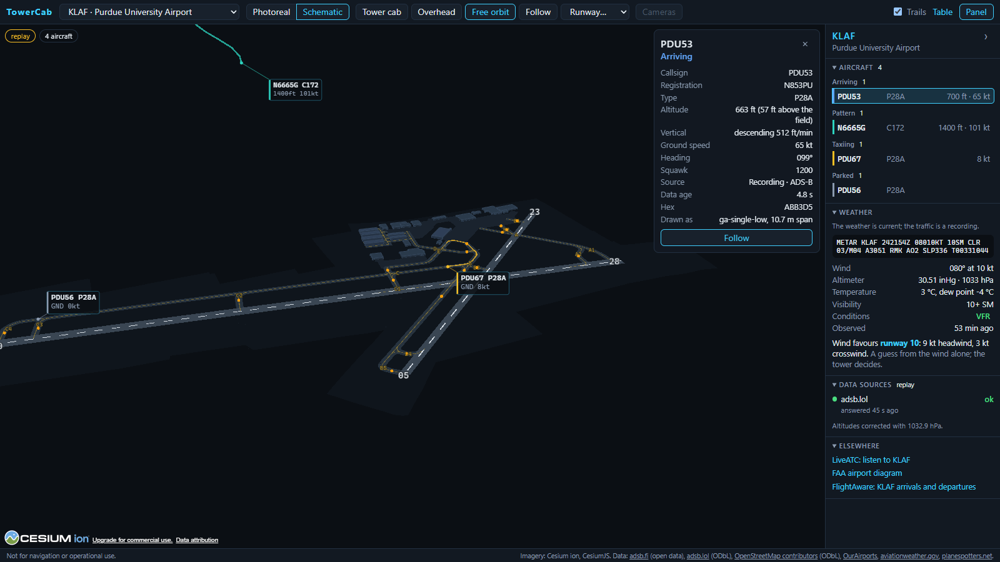
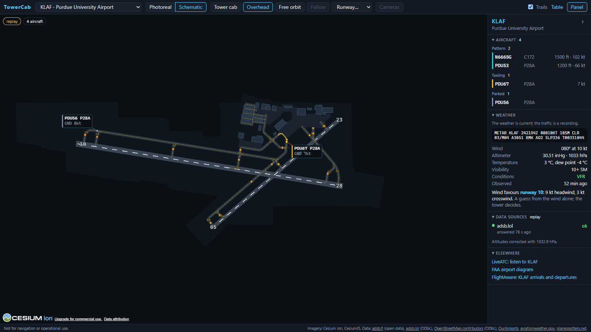
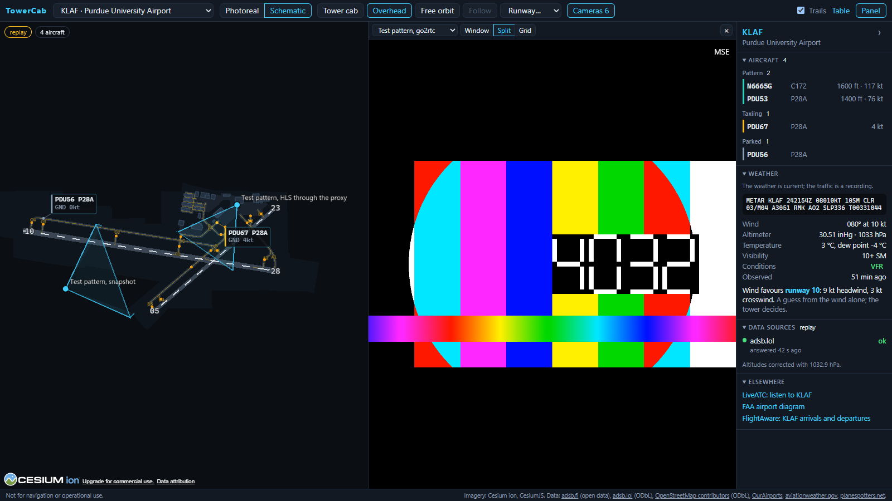
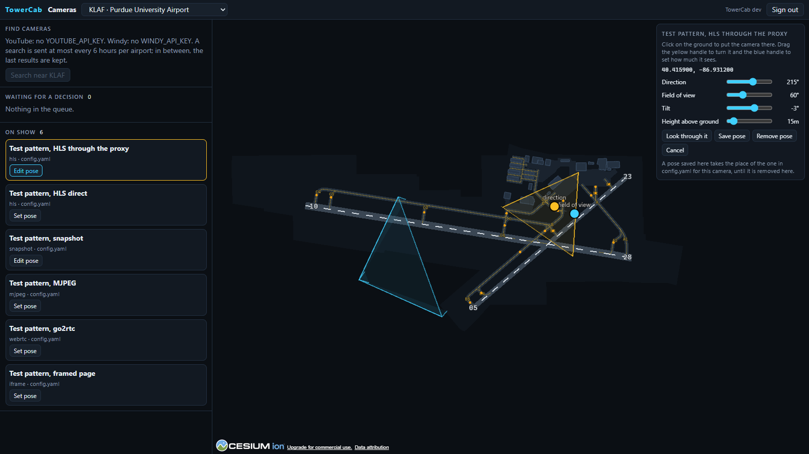
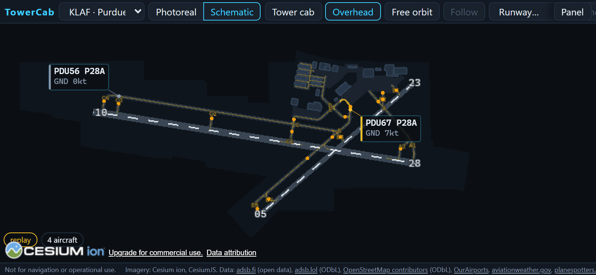

# TowerCab

Live aircraft around an airport in a 3D scene, like the view from the tower cab, in a browser.

> **Not for navigation or operational use.** Positions come from volunteers' receivers over the public
> internet. They are late, incomplete and sometimes wrong.



- Aircraft from public ADS-B services, or from your own receiver, moving smoothly between position reports,
  standing on the ground with their wheels on it.
- Two base maps: **Photoreal** (Google's photorealistic 3D tiles through a free Cesium ion token) and
  **Schematic** (runways, taxiways and buildings from OpenStreetMap), which needs no token at all.
- Views from the tower, from above, from each runway end, in orbit, or following one aircraft.
- A side panel with the traffic by phase of flight, the METAR, and how healthy each data source is.
- Details of the aircraft you select, with a photo of it, or a picture of its type when nobody has taken one.
- Live cameras you add yourself, beside the scene or laid over it with the aircraft labels on top.
- One container. The server fetches the traffic once per airport and shares it with every browser; when
  nobody is watching, it stops asking.

|                                                              |                                                         |
| ------------------------------------------------------------ | ------------------------------------------------------- |
|                       |  |
|  |       |

The pictures show Schematic mode with a recording of real traffic at Purdue University Airport, and a test
pattern standing in for a camera. They are taken by `pnpm screenshots`. There is no picture of Photoreal here
because Google's 3D tiles may be shown but not stored.

## Quick start

```sh
docker run -d --name towercab -p 8790:8790 \
  -v towercab-config:/config -v towercab-data:/data \
  ghcr.io/clucraft/towercab:latest
```

Open <http://localhost:8790>. You get two airports (KLAF and KIND) in Schematic mode with live traffic.
`/KLAF?replay=klaf-pattern` plays a recording, which is the quickest way to see it move when the sky is quiet.

For Photoreal, [get a Cesium ion token](#a-cesium-ion-token) and add `-e CESIUM_ION_TOKEN=...`.

### Docker Compose

```sh
git clone https://github.com/clucraft/towercab.git
cd towercab
cp .env.example .env     # optional: tokens go here
docker compose up -d     # add --build to build the image from source
```

### Unraid

[unraid/towercab.xml](unraid/towercab.xml) is a container template: the port, the two appdata folders
(`/mnt/user/appdata/towercab/config` and `.../data`) and every setting, with the secret ones masked.

It is not in Community Applications. Copy the file to the flash drive as
`/boot/config/plugins/dockerMan/templates-user/my-towercab.xml`; it then appears under **Add Container** in the
template list, where you fill in the token and press Apply.

The template runs the container as Unraid's own user (`--user 99:100`, under Extra Parameters), because that
is the owner Unraid gives the appdata folders it creates. If the folders are not writable all the same,
TowerCab still starts, with the built-in example config and a warning in the log that says which folder to fix.

Checked on Unraid 7.2.0: the template folder, the folder ownership, and a container created with exactly the
template's settings, which Unraid's Docker manager then lists with this template. The Add Container form
itself was not clicked through.

## Configuration

Everything lives in `/config/config.yaml`. On first start the server copies
[config/config.example.yaml](config/config.example.yaml) there; the comments in that file are the reference.
Edits are picked up while the server runs, and an edit that does not validate is logged and ignored.

| Section     | What it holds                                                                                               |
| ----------- | ----------------------------------------------------------------------------------------------------------- |
| `airports`  | The airports, with how far out and how high to show traffic. [Adding an airport](docs/ADDING_AN_AIRPORT.md) |
| `providers` | Which traffic sources to use and in what order. [Data sources](#data-sources)                               |
| `polling`   | How often to ask while someone is watching, and when to stop                                                |
| `cameras`   | Your cameras. Empty at first. [Adding a camera](docs/ADDING_A_CAMERA.md)                                    |
| `proxy`     | The hosts the server may fetch camera video from                                                            |
| `go2rtc`    | Address of a go2rtc instance, for your own RTSP camera                                                      |
| `discovery` | Camera search on the admin page                                                                             |
| `client`    | How far behind real time browsers draw (2.5 s by default)                                                   |
| `photos`    | Aircraft photos from planespotters.net and pictures of aircraft types from Wikimedia Commons, on or off     |

### Environment variables

Tokens and keys come from the environment. Every one is optional. See [.env.example](.env.example).

| Variable                                     | Purpose                                                           |
| -------------------------------------------- | ----------------------------------------------------------------- |
| `PORT`                                       | Port the server listens on. Default `8790`.                       |
| `PUBLIC_URL`                                 | The address people reach TowerCab at through a reverse proxy.     |
| `TZ`                                         | Time zone for log times.                                          |
| `LOG_LEVEL`                                  | `trace`, `debug`, `info`, `warn` or `error`. Default `info`.      |
| `CESIUM_ION_TOKEN`                           | Cesium ion token: Photoreal and terrain.                          |
| `GOOGLE_MAPS_API_KEY`                        | Google Map Tiles API key, as an alternative to ion for Photoreal. |
| `ADSBLOL_API_KEY`                            | adsb.lol API key. Without one adsb.lol allows 500 requests a day. |
| `OPENSKY_CLIENT_ID`, `OPENSKY_CLIENT_SECRET` | OpenSky OAuth2 client credentials (fallback source).              |
| `YOUTUBE_API_KEY`, `WINDY_API_KEY`           | Camera discovery on the admin page; Windy webcam pictures.        |
| `ADMIN_TOKEN`                                | Enables `/admin`. Admin routes do not exist when unset.           |

### A Cesium ion token

Photoreal and terrain need a Cesium ion account. The free Community plan is for personal and non-commercial
use and has monthly allowances (when this was written, for Google Photorealistic 3D Tiles: 1,000 "root tiles"
a month).

1. Sign up at <https://ion.cesium.com> and open the access tokens page, <https://ion.cesium.com/tokens>.
2. Create a token for TowerCab rather than using the default one. It needs only the `assets:read` scope.
3. If the Photoreal button stays unavailable, check in ion that Google Photorealistic 3D Tiles is enabled
   for your account.
4. Give it to TowerCab as `CESIUM_ION_TOKEN`.

**The token is sent to every browser that opens TowerCab.** That is how CesiumJS works, and it is why ion has
the safeguard below. Once TowerCab has a public address, restrict the token to it: on the token's page choose
"Selected Urls" and enter the address with its scheme, for example `https://towercab.example.com`. A token
restricted this way works only for requests that carry a `Referer` header, so do not strip that header at
your reverse proxy.

The same goes for a Google key (`GOOGLE_MAPS_API_KEY`): in the Google Cloud console, under the key's
"Application restrictions", choose "Websites" and add your address (`https://towercab.example.com`), and under
"API restrictions" allow only the Map Tiles API, which must also be enabled for the project.

Without either, TowerCab runs in Schematic mode on a flat surface.

### Behind a reverse proxy

TowerCab serves the page, its API and its WebSocket (`/ws`) from one port, all on the same origin, so one
proxy rule is enough: your host name to `http://<server>:8790`.

- **WebSocket.** The proxy has to pass WebSocket connections through. Zoraxy's README lists that as automatic,
  with no set-up. If the page says "reconnecting" and never "live", this is where to look. Camera streams from
  go2rtc also use a WebSocket (`/go2rtc/api/ws`), on the same host.
- **Client addresses.** TowerCab trusts `X-Forwarded-For` and `X-Forwarded-Proto`, so that the admin lock-out
  counts the real client and not the proxy. Do not expose port 8790 to the internet directly as well.
- **https.** Use it. The admin token travels in a request header.
- Set `PUBLIC_URL` to the public address.

This set-up was not tried behind Zoraxy during development; the WebSocket and the forwarded headers are
tested against the server directly.

## Using it

`/` lists the configured airports; `/KLAF` opens one.

| Key      | Does                                           |
| -------- | ---------------------------------------------- |
| `1`      | Tower view                                     |
| `2`      | Overhead view                                  |
| `3`      | Next runway end (press again for the next one) |
| `4`      | Orbit the field                                |
| `5`, `F` | Follow the selected aircraft                   |
| `C`      | Open or close the cameras                      |
| `S`      | Switch between Photoreal and Schematic         |
| `Esc`    | Clear the selection                            |

Add these to an airport's address:

| Parameter              | Does                                                                        |
| ---------------------- | --------------------------------------------------------------------------- |
| `?mode=schematic`      | Start in the Schematic base map (needs no token). `photoreal` is the other. |
| `?view=overhead`       | Start in a view: `tower`, `overhead`, `orbit` or a runway end (`rwy-10`).   |
| `?cam=<id>`            | Open a camera. `&camlayout=split`, `grid` or `overlay` picks the layout.    |
| `?replay=klaf-pattern` | Play a recording instead of live traffic.                                   |
| `?sim=150`             | Show that many simulated aircraft instead of live traffic.                  |
| `?quality=lite`        | Draw Photoreal with less detail, or with more: `high`. [Phones](#phones)    |
| `?sky=day`             | Keep it day, or show a moment. [Day and night](#day-and-night)              |
| `?fps`                 | Show the frame rate.                                                        |

`/debug/KLAF` shows the same traffic as a table with source health, `/admin` is the
[admin page](docs/ADDING_A_CAMERA.md#the-admin-page), `/healthz` is the health check and `/metrics` has
Prometheus metrics.

### Day and night

The sky follows the real sun over the airport: its height and direction are worked out from the airport's
coordinates and the time, so it is right wherever you watch from. The sun sets where and when it does there; then
come the colours of dusk, the stars and the moon. In Photoreal the ground goes dark with it, though never so dark
that you cannot see a taxiway: Google's pictures were taken by day, and are dimmed. It is always a clear sky.
Schematic keeps its dark map under a dimmed sky.

The side panel has the local time, sunrise and sunset in the airport's time zone, and a switch to keep it day, which
the browser remembers. `?sky=2026-11-25T22:20Z` shows the sky of any moment, for a look at the evening in the morning.

### Phones

On a phone, a tablet, or a computer with little memory, Photoreal runs with a lighter profile: coarser
tiles, less antialiasing, a smaller memory allowance and about 30 frames a second. It tries a sharper
picture when there is room for one and steps down when there is not. `?quality=high` and `?quality=lite` choose
for you, and `?fps` shows which is in use. Schematic is much the lighter of the two base maps.

If the browser takes the graphics away, which on phones mostly means memory ran out, the scene is built again
by itself, in Schematic if it was Photoreal that failed.

### Cameras

TowerCab ships with no cameras: add the streams you have checked yourself. A camera can be a YouTube live
video, an HLS or MJPEG stream, a picture that reloads, a page in a frame, or your own RTSP camera through
[go2rtc](https://github.com/AlexxIT/go2rtc). It shows in a window over the 3D view, beside it, in a grid, or,
once you have told TowerCab where the camera stands, as an overlay with the aircraft labels drawn over the
picture. The `/admin` page (set `ADMIN_TOKEN`) places cameras in the scene with the mouse and can search
YouTube and Windy for cameras near an airport; nothing it finds is shown until you approve it.

[docs/ADDING_A_CAMERA.md](docs/ADDING_A_CAMERA.md) has the details.

### Replay

`/KLAF?replay=klaf-pattern` plays a few minutes of real traffic at KLAF, recorded from adsb.lol (ODbL), in a
loop. It needs no data source and no token in Schematic mode.

To make your own recording from a running server:

```sh
pnpm record --airport KIND --minutes 10 --out kind-busy
```

The file lands in `.local/data/replays/`; on a deployed server put it in `/data/replays/` and open
`/KIND?replay=kind-busy`. Recordings made this way contain whatever sources your server used, so check their
terms before sharing one.

### Your own aircraft models

The aircraft are simple shapes generated by `pnpm gen:models`, one per class of aircraft. A `.glb` file in
`/data/models/` with the same name as a built-in one (`narrowbody.glb`, for example) replaces it.

## Data sources

The server fetches traffic once per airport and fans it out to browsers over WebSocket; browsers never call
these services. Limits below were checked in November 2026 and are enforced by the server.

| Source                                             | Default            | Limit                                     | Terms                                                  |
| -------------------------------------------------- | ------------------ | ----------------------------------------- | ------------------------------------------------------ |
| Your own receiver (readsb / tar1090 / ultrafeeder) | off                | none                                      | yours                                                  |
| [adsb.fi](https://adsb.fi)                         | on, preferred      | 1 request per second                      | personal, non-commercial use; credit and link required |
| [adsb.lol](https://adsb.lol)                       | on                 | 500 requests a day without a key (1)      | ODbL; attribution required                             |
| [airplanes.live](https://airplanes.live)           | off                | by agreement                              | ask `contact@airplanes.live` for access first          |
| [OpenSky Network](https://opensky-network.org)     | off, fallback only | 400 credits a day (4,000 with an account) | research and non-commercial use                        |

(1) adsb.lol also refuses bursts well inside that allowance, so the server asks it at most every 10 seconds.

**These terms make TowerCab a tool for personal, non-commercial use as it ships.** If you want to use it
commercially, use your own receiver and check each remaining source's terms.

Public services see little of what happens on the ground, because their receivers are rarely near the
airport. For the ramp and the taxiways, [use your own receiver](docs/RECEIVER.md).

Airport and runway data come from [OurAirports](https://ourairports.com/data/) (public domain), the airport
layout from [OpenStreetMap](https://www.openstreetmap.org/copyright) (ODbL), weather from
[aviationweather.gov](https://aviationweather.gov), aircraft photos from
[planespotters.net](https://www.planespotters.net), and pictures of aircraft types from
[Wikimedia Commons](https://commons.wikimedia.org), each with its author and licence.
[ATTRIBUTION.md](ATTRIBUTION.md) has the full list.

## Development

Requires Node 24 and pnpm 10.

```sh
pnpm install
pnpm dev        # server on :8790, web app on :5173 (proxying the API and WebSocket to the server)
pnpm check      # lint, typecheck, tests
pnpm build
pnpm test:e2e   # Playwright tests against the built app
```

In development the server keeps its config and data in a gitignored `.local/` folder at the repo root.
Set `CONFIG_DIR` and `DATA_DIR` to use other folders. Put tokens in `.env`, which is gitignored too.

Tools for checking the scene in a real browser: `pnpm probe` (frame rate, screenshots), `pnpm verify:scene`
(no jumps, no backward steps, wheels on the ground), `pnpm verify:surface` (in Photoreal, that the ground is where it
is drawn), `pnpm profile:phone` (what the scene costs on a slow device with a small screen), `pnpm soak` (30 minutes
against the live sources, fails on any rate-limit answer) and `pnpm screenshots` (the pictures in this file).
`pnpm check:types` checks the table of articles about aircraft types against ICAO and Wikipedia.

[docs/PLAN.md](docs/PLAN.md) is the build plan and [docs/DECISIONS.md](docs/DECISIONS.md) records every
decision and every place where the app differs from the plan, including what could not be verified.

## License

Code: [MIT](LICENSE). Third-party data, services and software keep their own terms; see
[ATTRIBUTION.md](ATTRIBUTION.md).
